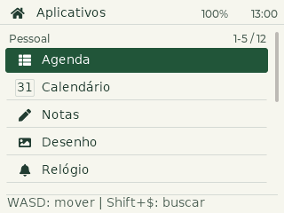

# PDA para o T-Deck original

Firmware de um PDA com teclado QWERTY, trackball e touch alternativo. A versão 0.2
implementa os aplicativos pessoais e persistência na flash interna.

## Aplicativos

| Aplicativo | Implementado |
| --- | --- |
| Agenda | Criar, editar, buscar, excluir, início/fim e lembretes enquanto ligado |
| Calendário | Mês, navegação em quatro direções, marcação de dias com eventos, vista diária |
| Notas | Lista, busca, título, texto UTF-8 e salvamento automático |
| Contatos | Nome, telefone, email, observações, busca e exclusão |
| Desenho | Arquivos, cursor pela bola, caneta, borracha, limpar e touch |
| Relógio | Ajuste automático por GPS ou manual, fuso fixo, cronômetro e temporizador |
| Calculadora | + - * /, parênteses, sinais e decimais |
| Planilha | A1:Z100, até 512 células preenchidas por arquivo e fórmulas |
| Ajustes | Brilho, tela por inatividade, som, salvamento e exportação para SD |
| Diagnóstico | Abas de bateria (tensão, carga estimada, mínimo/máximo), GPS e entradas (bola, teclado e touch) |
| Jogos | 10 jogos: 2048, Sokoban, Campo Minado, Sudoku, Forca, Batalha Naval, Cobrinha, Senha Secreta, Caça-palavras e Masmorra; tela cheia, partidas persistentes e 384 palavras em 24 temas |
| Mapa | Marginal Pinheiros e entorno da Zona Sul; vetores offline, busca de rua e número aproximado, zoom, movimento, nomes e GPS quando válido |
| Bluetooth | Teclado e mouse BLE para PC/celular; painel touch com modificadores, atalhos, setas, F1–F12 e símbolos ASCII; recepção básica validada no PC |



A interface mantém o estilo Essencial: listas com nomes e ícones leves dos
aplicativos, cinco itens completos no início, cabeçalho compacto e o mesmo
tratamento de botões e foco por teclado/bola em todos os aplicativos. Os ícones
usam a fonte já incluída; não exigem imagens ou novas bibliotecas.
O visual segue o protótipo Essencial: cabeçalho claro com hora local e porcentagem da bateria, fundo
neutro, separadores finos e seleção verde preenchida, sem animação de foco.

[Guia de uso](docs/GUIA.md) · [Persistência](docs/PERSISTENCIA.md) ·
[Validação](VALIDACAO.md) · [Arquitetura](docs/ARQUITETURA.md)

[Uso de memória](docs/MEMORIA.md): compactação sem perda dos dados do mapa e
configuração LVGL restrita aos componentes utilizados. Aplicativo medido em
5.221.377 bytes (79,7% da partição), com 1.332.223 bytes livres, incluindo
o gerenciador de destinos Bluetooth.
[Validação no T-Deck](docs/VALIDACAO-MEMORIA.md): instalação, buscas e persistência por USB.

[Jogos e controles](docs/JOGOS.md): funcionam por teclado, sem depender do trackball.
[Mapa vetorial e controles](docs/MAPA.md): funciona sem imagens, internet ou SD.
[Teclado e mouse Bluetooth](docs/BLUETOOTH.md): pareamento, controles e limitações.
[Validação dos jogos](docs/VALIDACAO-JOGOS.md), incluindo migração dos dados e
retomada das partidas após reiniciar o aparelho.

## Teclado e bola

- No início e nas listas, Shift+$ entra na busca. Backspace apaga a busca.
- Rolar a bola seleciona; clique ou Enter abre. Segurar a bola volta ao início.
- Em um campo, o teclado insere texto e a bola move o cursor. Clique encerra a
  edição para permitir escolher campos e botões. Enter insere linha em notas.
- Em calendário, planilha e desenho, `m` alterna entre conteúdo e menu de botões.
- `w/a/s/d` move cima/esquerda/baixo/direita em todos os apps, menus e diálogos.
  Enter abre o campo para escrever; durante a edição, WASD e `m` são texto normal.
  **Shift+$** alterna entre digitação e movimento do cursor por WASD. Nesse modo,
  Enter sai do campo para navegar nos botões. No início e nas listas, **Shift+$**
  alterna busca/digitação com navegação; permite buscar nomes começando por WASD.
- O botão **Símbolos** insere operadores, números e acentos por WASD, bola ou touch.
- A composição `_ -` sem espaço (`_-`) produz `=`; ela pode ser desligada em Ajustes.

## Dados e bateria

Os documentos e a sessão são salvos localmente, sem depender de USB, Wi-Fi ou SD.
O estado inclui app/documento aberto, modo de edição, cursor, célula selecionada,
desenhos, preferências e rascunhos de compromisso ainda incompletos.

O salvamento ocorre após **750 ms sem alteração**, em no máximo **5 s durante
edição contínua**, e ao sair para o início ou confirmar ações. Duas cópias
alternadas com geração e CRC permitem escolher a última cópia válida ao iniciar.
Falhas aparecem no rodapé e o conteúdo permanece em RAM.

Uma perda de energia pode descartar alterações ainda indicadas como `salvando…`.
Para desligar, aguarde `salvo` ou use **Ajustes > Salvar agora**. Isso também vale
para bateria descarregando: não é possível salvar depois que a alimentação acabou.

A tela reduz brilho após 30 s e apaga após 120 s, por padrão. Tecla, bola ou touch
acordam a tela; a primeira ação ao acordar apenas desperta. O sistema continua
executando os temporizadores com a tela apagada. Isso não é deep sleep, e a
porcentagem no cabeçalho é estimada pela tensão (3,3–4,2 V), atualizada a cada
10 s. A leitura não é calibrada para a curva da bateria e pode subir durante a
carga por USB; não representa uma estimativa de autonomia. Sem leitura válida,
o cabeçalho mostra `--%`.

Em **Diagnóstico > Bateria**, a barra mostra a carga estimada, com tensão em V e
mV, mínimo/máximo e número de leituras válidas desde que ligou. Os valores são
atualizados a cada 10 s; o histórico em RAM reinicia ao desligar. Nível baixo
aparece até 20%, e crítico até 10%. Leitura inválida aparece como indisponível.
Essa leitura não mede desgaste, capacidade real, ciclos, corrente ou estado de
carga por USB. A porcentagem é uma estimativa linear, não uma medida da saúde.

As abas **Bateria**, **GPS** e **Entradas** aceitam toque, teclas **1/2/3** e
**Tab** ou clique da bola para avançar. O movimento da bola continua sendo
registrado sem trocar de aba, para permitir testar os sensores. **b** abre a
bateria; **g** alterna entre GPS e entradas; segurar a bola volta ao início.

Após corte completo de energia, o relógio aguarda data/hora válidas do GPS ou
ajuste manual em **Relógio > Ajustar hora**. Com GPS válido, sincroniza ao receber
o sinal e confere a hora a cada minuto, respeitando o fuso configurado. Data salva é
apenas referência, não hora atual. Cronômetro retorna pausado; temporizador
retoma pela hora se ela for confiável, ou preserva o tempo restante pausado.
Não há alarmes com o aparelho desligado.

Se a área de dados estiver totalmente apagada, o primeiro boot prepara LittleFS.
Uma área desconhecida nunca é formatada automaticamente: nesse caso, os dados
ficam em RAM até **Ajustes > Preparar memória**, com confirmação na tela.

## Planilha

Exemplos: `=A1+B1`, `=(A1*2)/B1`, `=SUM(A1:A5)`, `=AVG(B1:B5)`,
`=MAX(A1:B3;10)`. Funções: `SUM`, `AVG`, `MIN`, `MAX`, `COUNT`.
Decimal com ponto, argumentos com `;` e intervalos com `:`. Fórmulas têm até
256 bytes, 32 níveis de referências e orçamento de operações. Erros de sintaxe,
ciclo, referência e divisão por zero aparecem na célula.

Limites: 32 notas de até 4096 caracteres (16 KiB UTF-8), 128 contatos, 128 eventos,
4 planilhas, 8 desenhos de 288 × 128. O snapshot completo tem limite de 1,4 MB;
um erro de capacidade é exibido, sem afirmar que a gravação terminou.

## Compilar e instalar

Com PlatformIO, dentro desta pasta:

```powershell
pio run -e tdeck
./tools/flash.ps1 -Port COM4 -SkipBuild
```

A atualização grava **somente o aplicativo em 0x10000**, preservando o mapa de
partições, bootloader e arquivos do PDA. Uma instalação inicial completa requer
o mapa de partições da placa; não use esse comando para migrar outro layout.

Nesta máquina, se `pio` não estiver no PATH:

```powershell
& C:/Users/gabri/.platformio/penv/Scripts/python.exe -m platformio run -e tdeck
```

As bibliotecas e a definição de placa estão incluídas em `lib/` e `boards/`,
com suas configurações e licenças preservadas. Basta clonar este repositório;
não é necessário manter outros projetos ao lado dele. O PlatformIO instala
Arduino-ESP32, as ferramentas e NimBLE-Arduino na primeira compilação.

## Testes e renderização

```powershell
./tests/run.ps1
cmake -S tools/preview -B build/preview -G Ninja -DCMAKE_BUILD_TYPE=Release
cmake --build build/preview --parallel 6
Push-Location build/preview
./pda_preview.exe
Pop-Location
python tools/preview/export_png.py build/preview docs/previews
```

O renderer usa o próprio shell LVGL, não uma recriação em HTML. Exercita fluxos
de todos os apps e restaura uma sessão após carregar as cópias salvas.

## Diagnóstico por USB

O [guia de ferramentas](tools/README.md) reúne os comandos de uso diário,
geradores e testes mantidos no projeto.

GPS externo ATGM336H: **Diagnóstico > GPS** (ou tecla **2**). A tecla **g** alterna entre GPS e entradas.
Mostra comunicação NMEA, pino/baud detectados, satélites usados, aviso da antena e
coordenadas somente com posição válida e recente. O receptor precisa de antena
GNSS adequada. Veja [GPS e preparação para mapa](docs/GPS.md).

`tools/device.py` usa pyserial da instalação do PlatformIO e aceita `status`,
`save`, `home`, `time --epoch SEGUNDOS_UTC`, `restart`, `gps --seconds 45` e `ball`. `home` simula
segurar a bola para sair também do Bluetooth; Escape nesse app é uma tecla remota. `ball` mostra contagens
independentes por interrupção e polling; veja o [diagnóstico da esquerda](docs/TRACKBALL.md).
O firmware também aceita
`PDA KEY N` e `PDA MOVE X Y` para exercitar as mesmas rotas de entrada via USB,
sem depender de touch automatizado. Esses comandos são locais à conexão USB.
O mesmo console aceita `bt-peers`, `bt-log`, `bt-manage` e
`bt-select --peer IDENTIDADE` para o gerenciador Bluetooth.

## Referências

[LilyGO T-Deck oficial](https://github.com/Xinyuan-LilyGO/T-Deck),
[LVGL](https://docs.lvgl.io/8.3/overview/indev.html),
[littlefs](https://github.com/littlefs-project/littlefs),
[licenças e avisos](THIRD_PARTY.md).
