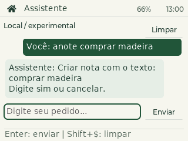

# Assistente integrado no T-Deck

O firmware padrão `tdeck` inclui o app **Assistente**, com o modelo português
embarcado. Funciona sem Wi-Fi. O chat usa os serviços locais e o mesmo estado
persistido dos aplicativos: você pode cadastrar e consultar sem sair da conversa.



## Usar no aparelho

No launcher, pressione **Shift + $**, digite `assistente` e pressione **Enter**.
Digite no campo inferior e envie com **Enter** ou **Enviar**. A bola rola o
histórico na vertical e move o cursor na horizontal. **Limpar** ou **Shift + $**
limpa a conversa, o rascunho e qualquer pedido aguardando confirmação.
Segure a bola por 700 ms ou use a casa para voltar ao launcher.

Digite **ajuda** ou **o que você faz?** para ver o resumo das funções.
**mais** percorre as páginas. Para ir direto aos exemplos de uma função,
use **ajuda notas**, **ajuda agenda**, **ajuda calendario**, **ajuda timer** ou **ajuda contatos**.
Se houver uma alteração aguardando confirmação, confirme ou cancele primeiro.

Cadastros, alterações, exclusões e timers mostram uma prévia: envie **sim** ou **confirmar** para executar,
ou **cancelar** / **não** para descartar. Enquanto houver uma prévia pendente,
outro pedido não a substitui. Uma confirmação é consumida uma única vez.
A troca de app conserva a conversa e a prévia na RAM; reiniciar as descarta.

| Função | Exemplos |
| --- | --- |
| Criar nota | `nota: trocar oleo do carro`, `anota que preciso comprar leite` |
| Consultar/editar notas | `minhas notas`, `le nota 1`, `edita essa nota: novo texto`, `apaga essa nota` |
| Criar contato | `contato Oficina: 11 99999-8888` |
| Consultar contato | `qual o telefone de Tamires?`, `num do Leo` |
| Criar evento | `evento Dentista 18/11/2026 09:00` |
| Criar lembrete | `lembrete Comprar leite 19/11/2026 18:00` |
| Consultar agenda | `agenda hoje`, `agenda amanha`, `qual meu proximo evento?` |
| Consultar/editar eventos | `meus eventos`, `le evento 1`, `remarca esse evento para 20/11/2026 10:30`, `exclui esse evento` |
| Consultar lembretes | `tenho algum lembrete pra hoje?` |
| Iniciar timer | `timer de 5 segundos`, `timer de cinco segundos`, `coloca um timer pra 2 minutos`, `timer 45s`, `cria um timer de meio minuto`, `timer 1h e 30min` |
| Consultar timer | `quanto tempo falta no timer?` |
| Alterar/cancelar timer | `altera o timer para 5 minutos`, `cancela o timer` |
| Calcular | `quanto e 288 dividido por 32,66`, `quanto e 12 vezes 5.3` |
| Calendário | `quando cai dia 8 de novembro`, `dia 8 de novembro mais 5 dias uteis` |
| Telemetria | `qnt % de bateria ainda tem?`, `q horas sao` |

Acentos não são necessários. As notas preservam o texto original, incluindo
acentos e números. O campo comporta **80 bytes**; acentos ocupam mais de um byte.
Veja [os comandos de leitura, edição e exclusão](CHAT-COMANDOS.md), incluindo
referências como essa nota, posições, paginação e confirmações.
Veja também [cálculos de calendário](CHAT-CALENDARIO.md): dias da semana,
intervalos, datas incompletas e dias úteis sem feriados.

## Datas, consultas e limites

- Datas de cadastro exigem dia, mês, ano e relógio válido. Aceita
  `evento Comprar pão 05/11/2026 09:00` ou
  `crie um evento para dia 5 de novembro de 2026 para comprar pão`.
  Sem horário, pergunta **Qual horário?**: responda `9h`, `09:00` ou
  `às 9 da manhã`. Depois revise a prévia e envie `sim`. `cancelar` ou
  limpar a conversa descarta também o pedido de horário. Ajuste o relógio em
  **Relógio → Ajustar hora**. Também aceita `crie um evento Comprar pão amanhã às 9h`
  e `me lembre de comprar leite hoje às 18h`. O fuso do PDA é respeitado;
  datas relativas usam o relógio e datas explícitas precisam incluir ano.
- Eventos são cadastrados sem aviso; lembretes avisam no horário informado.
  Não há duração final implícita. O aparelho precisa permanecer ligado para
  emitir o aviso; o firmware não oferece despertar de aparelho desligado.
- A agenda mostra o dia inteiro (até cinco itens, indicando os restantes), ou
  o próximo compromisso. Filtros por tarde e feriados ainda não são oferecidos.
- Contatos são procurados pelo nome salvo, primeiro exato e depois parcial.
  Se houver mais de um resultado, pede o nome completo. Parentescos não são
  inferidos: `meu pai` só encontra um contato cadastrado com esse nome.
- Um contato existente não é sobrescrito. Para editar ou apagar, use os apps.
- Todo timer exige confirmação, incluindo substituição de um timer em andamento.
  Ao terminar, mostra a notificação e repete os três bipes até dispensar o modal
  por **OK**, **Enter** ou **clique no trackball**, se **Ajustes → Som** estiver
  ligado. Use **Ajustes → Testar som** para conferir o alto-falante;
  veja [áudio e diagnóstico](AUDIO.md).
  Aceita `de`, `para` ou `pra`, unidades por extenso ou abreviadas, números
  simples por extenso (como cinco, doze e trinta), meio minuto, meia hora e
  combinações como `uma hora e dois minutos`. Também aceita decimal com vírgula,
  como `timer 1,5 minutos`, pontuação final e `por favor` no fim do pedido.
  Não descarta instruções extras como `e apaga as notas` para iniciar um timer.
- Cálculos usam o avaliador local: números, parênteses, +, -, *, / e palavras
  como vezes ou dividido por. Aceitam vírgula ou ponto decimal, não milhares.
- Listas de compras, mapas, chamadas, alarmes recorrentes, configurações e
  integrações externas ainda não estão conectados ao executor.

O modelo classifica intenções; não gera conversa livre. A execução depende de
uma gramática explícita, argumentos válidos e confirmação no chat. O rótulo
neural sozinho não autoriza uma alteração. Pedidos com restrições não suportadas
são recusados; notas podem conter negações como parte do texto.
As métricas e os limites do reconhecedor estão em [Modelo e treinamento](IA.md);
não estabelecem 99% de confiabilidade para o conjunto do assistente.

## Dados e serviços internos

`PdaServices` em `include/pda/assistant.h` fornece chamadas locais tipadas para
notas, contatos, eventos, lembretes e timers, além das consultas. Usa `System`,
IDs, limites e snapshots existentes, sem abrir telas. Edições e exclusões
invalidam somente a sessão de editor que apontava para o documento afetado.
`Assistant` cuida da interpretação e da prévia, separadamente dos serviços.

Após confirmar, o cadastro é gravado e aparece no app correspondente. Se a
persistência falhar, o chat informa que o item ficou apenas na RAM, mantém o
estado pendente de gravação e permite as tentativas normais do sistema. Repetir
`sim` não repete a criação. Limpar o chat não desfaz um cadastro confirmado.

As últimas **12 mensagens** e o rascunho ficam somente na RAM. Não entram nos
snapshots nem automaticamente no treinamento. Textos explicitamente confirmados
como notas/eventos/contatos passam a integrar os respectivos documentos.
O ID do Assistente não é gravado como app ativo; o esquema anterior permanece
compatível e a inicialização abre o launcher.

## Compilar, instalar e validar

```powershell
./tests/run.ps1
cmake -S tools/preview -B build/preview-chat -G Ninja -DPDA_CHAT_PREVIEW=ON
cmake --build build/preview-chat
# Execute pda_preview.exe em uma pasta de capturas sob build/.
./tools/flash.ps1 -Port COM4
```

O script de instalação salva o estado e confere o layout antes de gravar apenas
a aplicação. Não exige outra migração de partições ou gravação do filesystem.

`tests/assistant_test.cpp` testa serviços e diálogo em memória, incluindo criação,
confirmação única, cancelamento, UTF-8, ambiguidades, limites, relógio inválido,
matemática, timer, falha de gravação e recuperação após reiniciar.
O renderizador LVGL testa a conversa usando o modelo real e a criação de nota
por confirmação, além dos controles, histórico, rascunho e compatibilidade.

O teste físico usa apenas consultas e prévias canceladas, preservando os registros
e jogos do usuário; deixa o Assistente aberto e limpo:

```powershell
python tools/test_chat_device.py --port COM4 --output build/chat-integrado-teste
```

`PDA CHAT STATUS` informa atividade, número de mensagens, tamanho do campo e
último rótulo, sem expor o conteúdo da conversa. `PDA PT RUN <texto>` avalia
somente o reconhecedor, sem executar ações. Consulte [IA.md](IA.md) para
reproduzir treinamento e comparar Python, C++ e ESP32.
