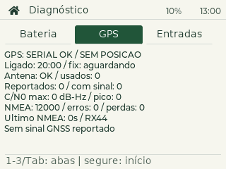
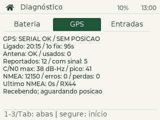

# GPS externo e preparação para mapa

O PDA lê o receptor GNSS por UART sem enviar comandos de configuração.
No ESP32-S3, a recepção usa uma tarefa própria e buffer de 8 KiB; os leitores
de posição, hora e diagnóstico usam mutex. Se a criação da tarefa ou do mutex
falhar, o firmware conserva a leitura pelo loop principal.
No T-Deck original, o conector Grove expõe alimentação, terra, GPIO43 e GPIO44.
O serviço procura NMEA com checksum válido, primeiro RX=44 a 9600 baud;
também testa RX=43 e 38400/115200/4800/19200/57600 baud. Cada combinação
é observada por 3 segundos. O TX do ESP permanece sem conexão à UART.
Se perder dados depois de detectar o módulo, conserva a configuração e informa
perda de sinal. Ajusta a hora do PDA automaticamente ao receber data e hora
válidas em uma mensagem RMC com checksum correto e status ativo (`A`).
Mensagens sem fix (`V`), sem data ou hora, com data inválida ou com mais de
1,5 segundo não são usadas para ajustar o relógio. Não salva coordenadas automaticamente.

A primeira sincronização ocorre assim que há uma leitura válida; depois,
o relógio é conferido a cada minuto e corrigido se a diferença for de pelo
menos 2 segundos. A tela usa o fuso definido em Ajustes; o GPS fornece UTC.
Sem sinal, o relógio continua contando e **Relógio > Ajustar hora** permanece
disponível. Com GPS válido, o ajuste automático prevalece na próxima conferência.
Depois de desligar completamente, é preciso receber GPS válido ou ajustar
manualmente novamente. `PDA STATUS` informa `PDA CLOCK` com UTC e validade do GPS.

Na tela, abra **Diagnóstico** e pressione **g** para alternar GPS/bola.
Satélites são os usados na solução, não a contagem total visível no céu.
Uma posição só aparece com mensagem indicando fix e coordenadas atualizadas há
menos de 5 segundos. Mensagens sem fix retiram a posição imediatamente.
`NMEA OK / SEM POSICAO` confirma comunicação, mas não confirma recepção GNSS.

## Resultado no aparelho em 28/10/2026

- PDA identificado por USB na COM4; inicialização e armazenamento funcionando.
- ATGM336H-5N-31: RX do ESP em GPIO44, UART 9600, 8N1.
- Observação inicial: 510 mensagens NMEA com checksum válido, zero erros,
  zero satélites usados e nenhuma posição válida.
- Mensagem recebida: `$GPTXT,01,01,01,ANTENNA OPEN*25`.
- O proprietário confirmou que comprou o módulo **sem antena**.

A comunicação elétrica e serial está confirmada. A recepção dos satélites e a
localização ainda precisam ser validadas com uma antena GNSS compatível conectada.
Uma janela aberta não substitui a antena. `ANTENNA OPEN` é diagnóstico da entrada
de antena; isoladamente não prova defeito, pois antenas passivas também podem
produzir esse aviso em receptores com detecção por corrente.
O tipo de conector e a alimentação de eventual antena ativa precisam ser
conferidos na plaquinha antes de escolher a antena.

## Repetir pelo computador

### Posição confirmada pelo usuário em 01/11/2026 à noite

Em 02/11, o usuário informou uma aquisição bem-sucedida na noite anterior e
enviou fotos do mapa em `GPS | seguindo` e da tela de diagnóstico. Portanto,
esse resultado é anterior à atualização da tarefa de recepção de 02/11.
A foto mostra `GPS: POSICAO OK`, quatro satélites usados, dez reportados/com
sinal, C/N0 máximo recente de 34 dB-Hz e pico da sessão de 44 dB-Hz, 3527
mensagens NMEA e zero erros. A última mensagem tinha idade de zero segundos.

O tempo ligado era 5:23 e a sessão já havia obtido fix. Esse valor é o tempo
decorrido até a foto; não mede o instante do primeiro fix, que pode ter ocorrido
antes. Não foram transcritas as coordenadas exatas da foto para este documento.

Isso confirma que o conjunto receptor/antena e o firmware anterior conseguem
produzir uma posição válida. A investigação passa a focar a demora e a
consistência da aquisição e da retomada. Os registros de bancada com zero
satélites não representam incapacidade permanente de recepção. O efeito da
atualização de 02/11 sobre o tempo de aquisição ainda não foi medido.

### Atualização em 31/10/2026 e teste sem PC

O usuário confirmou antena instalada e `Antena: OK` na tela, mas ainda não
obteve posição mesmo após 15–20 minutos a céu aberto, conforme confirmação
posterior. Não consegue manter o T-Deck conectado ao computador durante o teste
externo. A recepção continua pendente.

Os logs locais de 30/10 (`backups/gps-before/gps-com-antena-raw-2026-10-30.txt`
e `gps-antena-horizontal-2026-10-30.txt`) mostram NMEA válido sem erros,
`ANTENNA OK`, ausência de fix e GSV com zero satélites reportados para GPS e
BeiDou. Esses registros são anteriores ao passeio e não documentam o teste externo.
O estado da antena não confirma aquisição de sinal de satélites.

Na bateria, abrir **Diagnóstico** e pressionar **g** permite acompanhar o GPS
sem USB. Conferir se o contador NMEA continua subindo e se aparece
`POSICAO OK`. Como ensaio controlado, deixar o aparelho parado por 15–20 minutos
com vista ampla do céu, sem desligar durante o período. Esse intervalo é uma
janela de observação, não uma garantia nem especificação de tempo de fix.

A versão anterior mostrava apenas satélites usados. A revisão de 31/10 acrescenta
à mesma tela, acessível por **g**:

- Estado serial separado da posição e do diagnóstico de antena.
- Tempo ligado e indicação de que já houve posição válida nesta sessão.
- Satélites reportados por GSV e quantos grupos de satélite têm C/N0 positivo.
- Maior C/N0 recente em dB-Hz e pico desde a inicialização.
- Contadores NMEA válido/erros e idade da última mensagem válida.
- Orientação conforme ausência de dados, ausência de sinal reportado ou espera
  de posição; coordenadas atuais quando há fix válido.

GSV é aceito somente com checksum válido e ciclo completo em ordem. Dados
expiram em 10 segundos; ausência de GSV aparece como indisponível, não zero.
Talkers específicos têm preferência sobre o agregado GN; BD/GB são tratados
como aliases. Para receptores com várias mensagens por sinal da mesma
constelação, a tela usa o último ciclo completo daquele talker, sem somar sinais
duplicados. C/N0 zero significa que não há C/N0 positivo nesse ciclo, não uma
medição de ruído em zero dB-Hz. O estado serial expira em 5 segundos.

O pico e a indicação de fix ficam somente em RAM e sobrevivem à saída do app,
mas não ao desligamento/reinício. Não há gravação automática de trajetos ou
histórico GNSS em flash. `PDA GPS` também inclui a linha `GPS SKY` com os totais.




Validação da revisão: testes nativos de checksum, GSV vazio, ciclos incompletos,
agregado GN, aliases BD/GB, expiração, pico e perda de fix passaram. O renderer
LVGL verificou atualização ao vivo, alternância GPS/bola e altura sem rolagem.
Build ESP32-S3 passou (RAM estática 27.436 bytes; aplicativo 6.291.905 bytes).
SHA-256 de `firmware.bin`:
`86E8CC01BB945FEC2797A3E2F8ADB8E766AF96308C9CC496591C85540A975A40`.

Instalado na COM4 somente em `0x10000`, após salvar os documentos e ler a tabela
de partições do aparelho (app0 em `0x10000`, tamanho `0x640000`). Hash da gravação
verificado pelo esptool. Após reinício: `READY=1 STORAGE=1 DIRTY=0`, uma nota,
um contato e três eventos preservados. O receptor respondeu com RX44/9600,
NMEA sem erros, antena OK e `GPS SKY FRESH=1 SEEN=0 SIGNAL=0`; essa observação
na bancada não substitui o teste externo. A tela GPS foi aberta por comando de
tecla, com confirmação `PDA INPUT OK`.

Dentro de `pda-os`, com USB conectado:

```powershell
& C:/Users/gabri/.platformio/penv/Scripts/python.exe tools/device.py --port COM4 gps --seconds 45
```

O comando consulta a cada 2 segundos. `LOCK=1 FRESH=1` confirma fluxo NMEA
recente; `FIX=1` e a linha `GPS POSITION` confirmam posição. Datas/horas vazias
ou fora dos limites não são publicadas como UTC válido. Com um terminal serial,
`PDA GPS RAW ON` transmite amostras NMEA validadas e `PDA GPS RAW OFF` encerra.
As saídas podem conter localização exata; compartilhe apenas se desejar.

O firmware anterior compilado está em `backups/gps-before/firmware.bin`.
A atualização gravou somente o aplicativo em 0x10000; os dados em LittleFS e a
tabela de partições existente foram preservados. A tabela do aparelho foi lida
e conferida antes da atualização.

## Recepção independente da interface — 02/11/2026

A comparação com o projeto de navegação de `0015/map_tiles_projects` motivou
separar a leitura do GPS da interface. A tarefa `gps_rx` consulta a UART a cada
10 ms, com prioridade 2 e stack de 4096 bytes. O buffer passou de 2048 para
8192 bytes e o orçamento por passagem acompanha esse tamanho. Nenhum arquivo
de renderização do mapa foi alterado. O serviço continua somente recebendo:
não envia comandos PAIR, PCAS, reset, troca de constelações ou de frequência.

O diagnóstico mantém o pico de sinal e agora mostra `1o fix: Ns` depois da
primeira posição, mesmo que a recepção desapareça ao voltar para dentro.
Enquanto não houver posição, mostra `fix: aguardando`. `perdas` conta eventos
de buffer cheio/overflow da UART, não bytes nem mensagens perdidas. Os erros
de checksum continuam em um contador separado. O número de linhas da tela foi
mantido e o renderer verificou que o texto atualizado cabe abaixo das abas.

`PDA GPS` acrescenta:

- `GPS ACQUISITION`: tempos em milissegundos desde `gpsBegin()` até a primeira
  mensagem NMEA válida, primeiro ciclo GSV completo com C/N0 positivo e primeira
  posição válida. Os campos `NMEA`, `SIGNAL` e `FIX` indicam se cada evento já
  ocorreu; tempo zero com flag zero significa que ainda não ocorreu. Não são
  medidas desde a energização física do receptor.
- `GPS UART`: tamanho solicitado do buffer, maior fila observada no início de
  uma passagem (`HIGH_WATER`), eventos de buffer cheio (`FULL`), overflow da
  FIFO (`OVERFLOW`), erros de enquadramento/paridade (`FRAME`) e maior intervalo
  entre passagens (`MAX_POLL_GAP_MS`). Esses eventos podem ser observados durante
  a busca de baud/pino, quando o candidato ainda não corresponde ao receptor.

Os tempos, o pico e os contadores ficam em RAM; não gravam trajeto ou coordenadas
automaticamente. Sair do diagnóstico ou do mapa não interrompe a recepção.
Desligar ou reiniciar apaga o resumo da sessão.

### Validação de bancada

Todos os testes nativos passaram, incluindo checksum, perda de fix, UTC,
expiração e ciclos GSV. Foram acrescentados testes dos tempos de aquisição,
retenção do primeiro fix após perda, reinicialização da sessão e drenagem de
uma rajada maior que o orçamento antigo de 2 KiB. O renderer LVGL também passou.

Build T-Deck: RAM estática 27.948 bytes; aplicativo 6.307.184 bytes no arquivo
`firmware.bin`, dentro da partição app0 de `0x640000` bytes. SHA-256:
`0D89A22693BF15FCA5D8909469EAFB56EE8C6C2698A95CA49B72675EBA1C3A8B`.

Instalado na COM4 somente em `0x10000`, após `PDA SAVE` e leitura/conferência da
tabela de partições. O esptool confirmou o hash da gravação. Antes/depois:
`READY=1 STORAGE=1 DIRTY=0`, uma nota, um contato e três eventos. A tentativa de
copiar a partição do aplicativo anterior pela USB foi interrompida por lentidão;
não foi produzido backup integral dessa versão. A tabela lida, o novo binário
e os registros de bancada estão em `backups/gps-reception-2026-11-02/`.

O receptor foi reconhecido em RX44/9600 após 60 ms desde o início do serviço.
Até 33 segundos de sessão: 336 mensagens válidas, zero checksum inválido,
buffer cheio, overflow e erros de enquadramento. Intervalo máximo de leitura:
10 ms. Em seguida, um ensaio abriu o mapa existente e enviou 24 movimentos;
a recepção continuou aumentando os contadores, ainda sem erros, com fila
máxima observada de 32 bytes e intervalo máximo de 34 ms. Ao fim, o aparelho
ficou em **Diagnóstico > GPS**, com os documentos preservados.

Nesse ambiente de bancada: antena OK, zero satélites reportados, zero C/N0 e
nenhum fix. Isso valida o transporte e a execução em segundo plano, mas não
demonstra melhora no tempo de aquisição de satélites. A mensagem RMC apresentou
modo `M` com status `V`; conforme o protocolo CASIC, `M` indica ausência de fix
com posição externa ou histórica disponível. Isso não basta para concluir que
o módulo esteja configurado incorretamente; o status inválido continua sendo
respeitado pelo firmware.

### Uma única observação externa, quando for conveniente

Não é necessário sair repetidamente nem manter o PC conectado. Quando já for
sair, use o aparelho na bateria com antena conectada e vista ampla do céu;
acompanhe **Diagnóstico > GPS**. Ao voltar, mantenha o aparelho ligado para
preservar os tempos, pico e indicação do primeiro fix. O resumo pode ser lido
pela tela ou depois pelo comando `PDA GPS` via USB. Uma perda de posição dentro
de casa não apaga o resultado anterior.

Mesmo sem sair, os novos contadores permitem verificar comunicação e perdas.
Se uma observação externa continuar sem satélites/C/N0, o próximo foco será a
antena, conexão, alimentação, interferência e configuração do receptor, sem
atribuir o problema à renderização nem repetir alterações de mapa.

Referências da investigação:

- [Driver LC76G com tarefa de recepção](https://github.com/0015/map_tiles_projects/blob/main/v2/01.Navigation_ESP32-S3-Touch-AMOLED-1.75/main/gps_lc76g.c).
- [Fonte de posição: configuração a 5 Hz específica do LC76G](https://github.com/0015/map_tiles_projects/blob/main/v2/01.Navigation_ESP32-S3-Touch-AMOLED-1.75/main/gps_source.c).
- [Protocolo CASIC do fabricante, RMC e modo M, p. 11](https://icofchina.com/d/file/xiazai/2020-09-22/20f1b42b3a11ac52089caf3603b43fb5.pdf).

## Mapa

O aplicativo [Mapa](MAPA.md) inclui vetores offline da Marginal Pinheiros e
entorno da Zona Sul na própria flash, sem imagens e sem depender de microSD.
Já pode ser explorado manualmente. Com a antena instalada, validar posição
estável, idade das coordenadas, satélites e HDOP. O marcador e o acompanhamento
usam somente posição válida e recente dentro do recorte.

## Referências

- [Exemplo GPS oficial LilyGO](https://github.com/Xinyuan-LilyGO/T-Deck/blob/master/examples/GPSShield/GPSShield.ino).
- [Manual ATGM336H-5N, fabricante ZhongKe, cópia em inglês](https://www.tinytronics.nl/product_files/002176_ATGM336H.pdf), especialmente seções 1.11, 2.7 e 2.8.
- [Protocolo CASIC do fabricante, diagnóstico TXT de antena](https://www.icofchina.com/d/file/xiazai/2017-05-02/ea0cdd3d81eeebcc657b5dbca80925ee.pdf).
