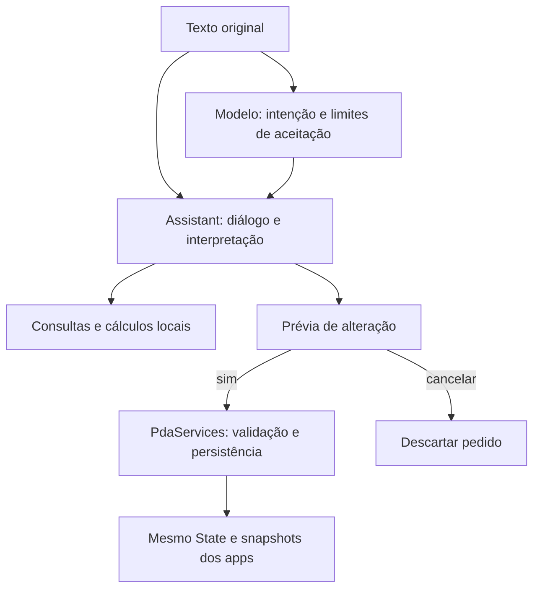

# Modelo e assistente: manutenção e reprodução

O firmware padrão `tdeck` inclui o Assistente. Há um único modelo mantido em
`data/ai/intent_pt.bin`, um relatório em `intent_pt.json` e um corpus congelado
em `data/ai/dataset/`. O modelo atual é a revisão 6, com perfil de características
5. Os nomes dos arquivos são estáveis; versões anteriores não são dependências.

## O que é aprendido e o que é código

O modelo é um **classificador de intenções em português**, treinado do zero em
CPU. Não gera texto, resumos ou histórias. Recebe até 80 bytes UTF-8 e escolhe
uma de nove classes:

`RECUSAR`, `BATERIA`, `HORA`, `AGENDA`, `CONTATO`, `CALCULO`, `TIMER`, `NOTA`,
`ABRIR_APP`.

O modelo fornece uma pista. O chat primeiro oferece rotas explícitas para
comandos conhecidos. Os argumentos vêm do texto original, nunca dos tokens
normalizados do modelo. Os serviços validam os dados, mostram prévias e
executam alterações somente após confirmação no chat.



Notas, eventos, lembretes, contatos, timers, calculadora, calendário, bateria e
hora estão conectados conforme [os comandos](CHAT-COMANDOS.md) e
[o calendário](CHAT-CALENDARIO.md). A classe `ABRIR_APP` ainda não abre telas no
chat. Consultas de telefone usam os nomes salvos; parentescos não são inferidos.

## Modelo atual

| Item | Valor |
| --- | --- |
| Entrada | 1.024 características de texto por hashing |
| Rede | Linear → tanh → dropout 0,1 no treino → linear de 9 saídas |
| Parâmetros | 33.097, float32 |
| Binário | 132.420 bytes, incluindo cabeçalho |
| Seleção | Semente 41, época 22 |
| Limiares | Confiança 0,99; margem entre as duas maiores classes 0,5 |
| Treino / calibração / avaliação | 22.132 / 2.152 / 112 exemplos |
| SHA-256 | `828bf12fe7bffc840b2659ad431861354bcc0625af8ab6229c57446a543d0064` |

Os limiares são limites de aceitação, não uma garantia de 99% de confiabilidade.
Na avaliação congelada, 37 dos 39 aceitos estavam corretos (**94,87%**), com
cobertura de 37/48 pedidos válidos (**77,08%**) e duas aceitações indevidas entre
64 pedidos fora de escopo. Na calibração, foram 959/964 aceitos corretos
(99,48%), com cobertura de 959/1.415 válidos (67,77%). São conjuntos diferentes.

A avaliação contém frases escritas pelo desenvolvedor antes da seleção; não é
um estudo independente com usuários. `user_regression.json` preserva as 34 frases
da última rodada, em pares correlacionados. São regressão conhecida, sem usá-las
como prova nova de generalização. A qualidade do classificador também não mede
sozinha o sucesso das APIs, extração de argumentos ou execução do assistente.

## Preparação das entradas

`tools/ai/text_features.py` é a especificação Python atual. Ela reúne:

1. Normalização de caixa/acentos, números substituídos por `#` e tokenização.
2. Expansão explícita de abreviações: `qnt`, `hj`, `cel`, `bat`, `calc` etc.
3. Tratamento lexical de comandos e mascaramento de conteúdo de notas/nomes.
4. Hashing de palavras, pares de palavras e n-gramas de caracteres.
5. Limite por característica e normalização do vetor.

Isso é engenharia de características, além do aprendizado dos pesos.
As variações dos comandos do produto ficam separadas, em `assistant.cpp`:
`commandText` prepara apenas os prefixos e verbos, preservando os argumentos;
os interpretadores de cada função validam o pedido. `assistantTelemetryIntent`
reconhece consultas explícitas de bateria/hora mesmo sem aceitação neural.
Os casos em `languageVariationTests` verificam sinônimos, texto original,
cancelamento, dados ambíguos e instruções compostas. Acrescentar um sinônimo aqui
não altera as métricas nem as características do classificador.

`policy.py` aplica restrições conservadoras às classes neurais. Algumas classes
recusam pedidos que o executor atual já suporta por gramática explícita; por
exemplo, cadastro de contato. Isso não impede a rota validada de `contato Nome:
telefone`. Também não autoriza novas ações apenas porque a rede aceitou uma frase.

`src/core/intent_pt.cpp` espelha a matemática e a preparação para o ESP32.
As tabelas `intent_pt_folds.inc` e `intent_pt_short.inc` são geradas:

```powershell
python tools/ai/generate_pt_folds.py
```

Ao mudar características/política, regenere as tabelas, treine um modelo
compatível e valide Python/C++. A integridade recusa combinar pesos com uma
especificação alterada sem treino ou uma migração comprovadamente equivalente.

## Ambiente e treino reproduzível

Execute na raiz `pda-os`. Use Python compatível com as versões fixadas em
`tools/ai/requirements-reference.txt`. O ambiente usado no projeto tem PyTorch
CPU 2.5.1 e NumPy 1.26.4; não é necessária GPU. Dependências locais ficam fora
do Git:

```powershell
python -m pip install --target .pio-tools/ai torch==2.5.1+cpu --index-url https://download.pytorch.org/whl/cpu
python -m pip install --target .pio-tools/ai numpy==1.26.4
python tools/ai/check_assets.py
python tests/ai_dataset_test.py
python tools/ai/train_pt.py --dataset data/ai/dataset --feature-profile 5 --selection coverage --target-precision 0.99 --seeds 7 19 41 --epochs 180 --output build/ai-training
```

Diretórios de saída precisam ser novos. O script usa dois threads, minibatches
de 64, AdamW (taxa 0,005, weight decay 0,01), pesos de classe e parada após 25
épocas sem melhoria. Seleciona checkpoint/semente pela cobertura correta na
calibração, respeitando a precisão empírica alvo, com perda como desempate.
Confiança e margem também são escolhidas na calibração.

O treino **não avalia o conjunto reservado**. Ele exporta `intent_pt.bin`,
`report.json` e as cópias efetivas de treino/calibração. Na limpeza do projeto,
o comando acima voltou a selecionar 41/22 e reproduziu os pesos byte a byte no
mesmo ambiente. Bibliotecas/hardware diferentes podem mudar resultados numéricos;
confira o hash e os resultados, sem presumir igualdade entre ambientes.

## Avaliar, comparar e medir no aparelho

Depois de congelar o candidato, execute a avaliação separada:

```powershell
python tools/ai/evaluate_pt.py --model build/ai-training/intent_pt.bin --cases data/ai/dataset/evaluation.jsonl --output build/ai-evaluation
python tools/ai/evaluate_pt.py --model build/ai-training/intent_pt.bin --cases data/ai/user_regression.json --output build/ai-user-regression
python tools/ai/validate_pt.py --training build/ai-evaluation
```

O último comando compila `pt_host.cpp` e compara características, probabilidades
e classes com o Python, incluindo UTF-8 e entradas no limite. O conjunto atual
teve 112/112 classes iguais, erro máximo de característica de cerca de 3,03e-8
e de probabilidade de 3,58e-7.

O firmware padrão inclui `PDA PT RUN <texto>`, uma rota de diagnóstico do mesmo
modelo que **nunca executa ações**. Instale primeiro os pesos correspondentes ao
diretório avaliado e compare:

```powershell
python tools/ai/validate_pt_device.py --port COM4 --training build/ai-evaluation --model-id pt-current --output build/ai-device
```

O teste confere rótulos, probabilidades/margens, limites, heaps e estados dos
jogos. `MODEL=pt-current` identifica essa rota; os resultados devem corresponder
aos pesos avaliados. Na consolidação de 04/11/2026, houve paridade de 112/112
classes da avaliação e 34/34 da regressão no S3. As medianas foram 9,33 ms e
9,10 ms, respectivamente; não são medidas de geração de texto. Passaram os
limites de entrada, a integridade do heap e a preservação dos dez jogos.

## Acrescentar exemplos e criar uma revisão

Os arquivos JSONL têm um objeto por linha:

```json
{"text":"mostre a carga que sobrou na bateria do meu PDA","label":"BATERIA","family":"bateria-consulta-nova-a","source":"reviewed-manual"}
```

Uma família reúne variantes do mesmo template/forma de pedir. Todas as variantes
relacionadas ficam no mesmo conjunto. Separe calibração por famílias diferentes;
inclua negativas, ambiguidades, erros naturais e pedidos fora de escopo. Não
aumente artificialmente a diversidade apenas trocando números ou nomes.

Prepare uma cópia, sem editar o corpus publicado:

```powershell
python tools/ai/prepare_dataset.py --base data/ai/dataset --add-train novos-treino.jsonl --add-calibration novos-calibracao.jsonl --evaluation nova-avaliacao.jsonl --version 7 --output build/ai-dataset-next
python tools/ai/train_pt.py --dataset build/ai-dataset-next --output build/ai-next
```

O preparador verifica rótulos, limite de 80 bytes, sobreposição de texto
normalizado, famílias entre conjuntos, regressões conhecidas e hashes da base.
Recusa duplicatas em vez de descartá-las silenciosamente. Não consegue provar
independência semântica de paráfrases: essa revisão é humana.

Para reproduzir somente a cópia congelada, omita as adições e use
`--output build/ai-dataset-copy`. Para alegar melhoria nova, prepare e rotule uma
avaliação inédita antes dos ajustes. Avaliações consultadas para corrigir erros
passam a ser regressão; não são mais testes cegos.

## Acrescentar uma função do PDA

1. Implemente uma API tipada em `PdaServices` ou no domínio apropriado, com
   limites e persistência. Reuse `System` e `State`; não simule cliques em apps.
2. Acrescente interpretação em `Assistant::respond`/`records`. Use o texto
   original para valores, nomes e conteúdo; peça esclarecimento quando faltar dado.
3. Para alterações, use uma prévia e uma ação pendente consumida uma vez. Guarde
   ID interno/campos esperados e recuse confirmações obsoletas. Posições da tela
   não são identidades permanentes.
4. Cubra confirmação/cancelamento, erro de gravação, dados ambíguos, limites e
   retomada. Teste a interface em `tools/preview` e só use registros sintéticos
   identificáveis nos ensaios físicos.
5. Atualize `helpPage` e os guias. Calendário e variações de timer foram ampliados
   assim, sem precisar mudar os pesos.

Treine novamente quando a mudança envolver o reconhecedor. Uma nova classe
também exige atualizar `LABELS`, dimensões/nomes no runtime C++, políticas,
exportação e validadores; não basta escrever um rótulo novo no JSONL.

## Promover um candidato

Após comparar o candidato com a base e revisar regressões, mantenha somente o
novo conjunto publicado em `data/ai/dataset/`, copie o binário para
`data/ai/intent_pt.bin` e o `report.json` correspondente para `intent_pt.json`.
Preserve os resultados da avaliação no relatório. O relatório precisa conter os
hashes atuais de `runtime_spec_sha256` e os hashes dos dados usados.

```powershell
python tools/ai/check_assets.py --refresh
./tests/run.ps1
python -m platformio run
./tools/flash.ps1 -Port COM4 -SkipBuild
```

`--refresh` atualiza o manifesto após revisão, mas não ignora divergência entre
pesos, relatório, corpus e código de preparação. Nunca promova só porque um
escore de calibração ficou alto. Veja os testes de aceitação e o procedimento
de gravação em [CHAT.md](CHAT.md) e [PARTICOES.md](PARTICOES.md).

## Limites e próximos estudos

Resumos, definições e histórias não fazem parte deste classificador. Resumos
extrativos e dicionário offline podem usar algoritmos/bases locais. Geração
livre exige outra arquitetura, orçamento completo de memória/CPU e avaliação
em português. O aparelho tem 16 MB de flash e aproximadamente 8 MiB de PSRAM;
flash, RAM e capacidade de raciocínio não são intercambiáveis.
