# Jogos pelo teclado

Abra **Jogos** pelo início. Selecione com WASD/Enter ou pressione 1–9 e 0 para o
décimo jogo. A lista rola para mostrar os demais títulos.
Durante a partida, todos os jogos usam tela cheia, com controles compactos no
topo e tabuleiros maiores. Caça-palavras, Campo Minado, Sokoban e 2048 dedicam toda a área
abaixo dos botões à grade, sem título, painel lateral ou rodapé de instruções.
Nos demais jogos, o rodapé indica o salvamento; a Masmorra usa sua própria faixa
de mensagens. O cabeçalho normal volta ao sair para a lista.
Cada jogo mantém sua própria partida, inclusive ao abrir outro aplicativo ou
reiniciar o aparelho. Aguarde **salvo** antes de cortar a alimentação.

Em uma partida, **M** volta à lista de jogos; **N** pede para começar de novo,
com confirmação; **?** abre ajuda. O botão Ajuda também funciona por touch.
Na **Forca**, as letras são tentativas: **Enter** volta aos jogos e **Backspace**
pede nova palavra com confirmação. Espaço após vitória/derrota começa outra palavra.
Segurar o clique da bola ou tocar a casa continua voltando ao início do PDA.

| Jogo | Controles e objetivo |
| --- | --- |
| 2048 | Grade padrão 4×4 (16 casas), ampliada na tela. Pontos, recorde e jogadas ficam em Ajuda → Partida. WASD desliza as peças. Iguais se fundem uma vez por jogada. U desfaz a última jogada, inclusive a peça sorteada. Chegar a 2048 permite continuar. Recorde é mantido ao começar de novo. |
| Sokoban | WASD anda e empurra caixas `O` até os alvos `+`. `@` é o jogador; caixa verde está no alvo. U desfaz um passo. São 24 fases, todas em 16×12 e com quatro a seis caixas. Enter após vencer avança. N reinicia a fase atual. Ajuda reúne Partida, Controles e Fases; a troca de fase pede confirmação. |
| Campo Minado | Novas partidas: grade 16×13 com 40 minas e fonte de 12 px. WASD move; Enter/espaço abre; F põe/tira bandeira. A primeira abertura e a vizinhança são seguras. Abra as 168 casas sem mina para vencer. Contagens e resultado ficam em Ajuda → Partida. Não há desfazer. |
| Sudoku | WASD seleciona; 1–9 preenche. Enter/espaço alterna 1–9/vazio sem precisar de modificadores. Backspace ou 0 apaga. H dá o valor correto da casa; U desfaz uma edição/dica. Pistas fixas são protegidas; conflitos ficam vermelhos. Enter após vencer ou N confirmado abre o próximo puzzle. |
| Forca | Digite A–Z para tentar letras, inclusive WASD/M/N. São 384 palavras em português e 24 temas; seis erros encerram a rodada. Maiúsculas/minúsculas são equivalentes, letras repetidas não contam e acentos são aceitos pela letra base: A revela a/á/ã/â e C revela c/ç. A grafia original aparece na palavra. Enter volta aos jogos; Backspace pede nova palavra. |
| 6 — Batalha Naval | Contra o PDA, em dois tabuleiros 8×8. Sua frota fica à esquerda e o adversário à direita. Posicione barcos de 4, 3, 3 e 2 casas usando WASD/Enter; espaço gira. R posiciona automaticamente. Depois, WASD escolhe alvo e Enter dispara. Cada tiro novo dá um turno ao PDA; repetir uma casa não gasta turno. X é acerto e ponto é água. |
| 7 — Cobrinha | WASD muda a direção; Enter pausa/continua. Coma as frutas, evite paredes e o próprio corpo. Começa pausada e acelera conforme cresce. M/início pausa a partida; ao reabrir ou reiniciar, retoma pausada. Avisos de agenda/timer também pausam. Não é possível fazer meia-volta sobre o pescoço. |
| 8 — Senha Secreta | Descubra quatro números de 1 a 6, com repetições possíveis, em dez tentativas. A/D escolhe posição, W/S altera número; 1–6 também preenche. Enter confirma. `=` conta posições exatas; `~` conta números corretos em outra posição, sem contar o mesmo número duas vezes. R limpa a tentativa atual. |
| 9 — Caça-palavras | Dez palavras sorteadas entre 24 temas numa grade 16×13, sem acentos e com fonte de 12 px. WASD move e Enter marca início/fim. Aceita horizontal, vertical, diagonal e ordem invertida. Espaço/R cancela a seleção. A lista e o tema ficam em Ajuda → Palavras; as instruções ficam na aba Controles. As palavras encontradas ficam marcadas na lista e na grade. Abrir a ajuda preserva a seleção em andamento. |
| 0 — Masmorra | Labirinto por turnos em três andares, agora com grade 19×13 em tela cheia. WASD anda/ataca; H cura; Q escudo; X bomba; F ou espaço defende; Enter espera. M volta aos jogos; N pede nova aventura. |

Partidas antigas do Sokoban em 8×8 podem ser continuadas; Nova, troca ou avanço
de fase passa para 16×12. As fases 13–24 maiores da revisão anterior não mudaram.
Partidas antigas do Campo Minado conservam a grade 9×9 com dez minas; as do
Caça-palavras conservam 10×8 e seis palavras. Escolher Nova começa no tamanho
maior, com confirmação. As novas grades têm 208 casas e cabem inteiras na tela.

O Sudoku tem 16 puzzles com solução única. Os primeiros oito têm 38 pistas;
os demais têm 32 pistas ou mais, conforme a remoção que preserva solução única.
Não há limite de tempo nem dependência da hora ajustada.

Os dados das fases são próprios, gerados por `tools/generate_game_levels.py`.
Sokobans são construídos por movimentos reversíveis e têm sua solução testada.
Os Sudokus são verificados por busca de soluções antes de entrar no firmware.
Não há download de conteúdo nem necessidade de Wi-Fi ou cartão SD.

O salvamento inclui tabuleiros, bandeiras, casas preenchidas, seleção, pontuação,
recordes, fase/puzzle e um passo de desfazer nos jogos que oferecem essa ação.
O gerador aleatório também é salvo, para desfazer 2048 sem mudar o sorteio.
A Forca salva a palavra, letras tentadas, erros, resultado e total de vitórias.
O alfabeto A–Z fica inteiro na tela: verde marca acertos, vermelho marca erros;
seis indicadores acima da palavra mostram as tentativas restantes.
Seu banco próprio está em `src/core/hangman_words.h`; os índices existentes são
mantidos para preservar a compatibilidade das partidas. Os 16 temas acrescentados
são Frutas, Aves, Vida aquática, Transportes, Profissões, Esportes, Instrumentos,
Cores, Roupas, Tecnologia, Astronomia, Plantas, Casa, Geografia, Sentimentos e Tempo.
O Caça-palavras usa o mesmo banco e evita repetir o tema da rodada anterior ao
pedir uma grade nova. A Forca também evita repetir imediatamente a palavra.

Os novos jogos também preservam frota e tiros, corpo/fruta/direção da cobra,
tentativas da senha e seus resultados, palavras e seleções encontradas, mapa
explorado da masmorra, vida, poções, tesouros e gerador aleatório. A Cobrinha não
corre em segundo plano. Os demais jogos avançam somente por ações do jogador.

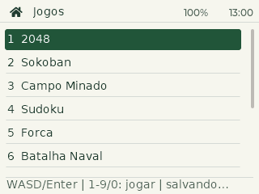
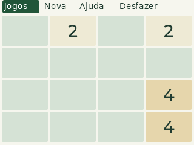
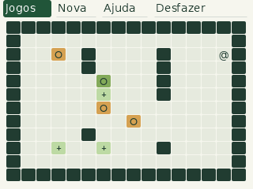
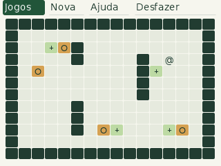
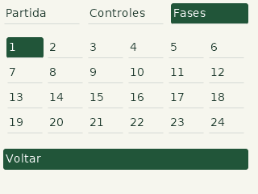
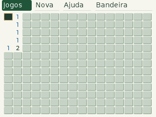
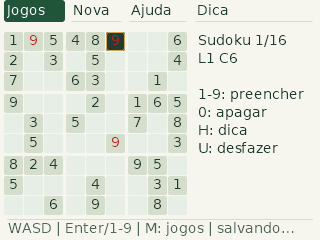
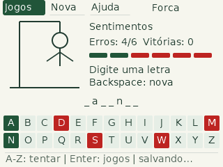
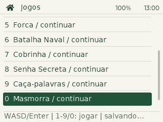
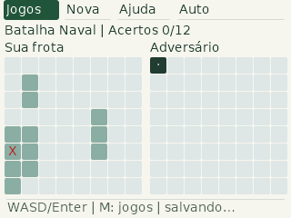
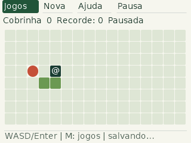
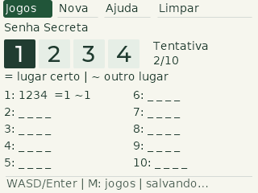
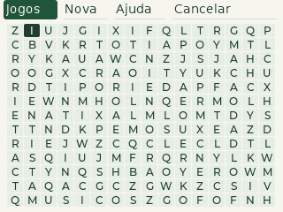
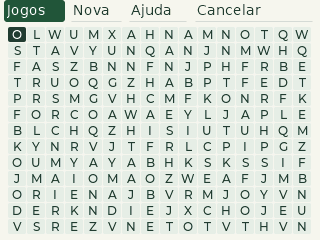
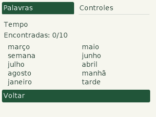
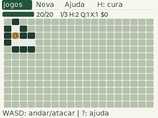

## Masmorra expandida

A geração continua escavando caminhos com retorno nos becos sem saída e abrindo
alguns atalhos. A grade passou de 11×9 para 19×13 (247 casas), com o mapa inteiro
na tela e descoberta gradual dos corredores e paredes próximas. A barra de vida, o valor numérico e o inventário
ficam no topo; a barra fica vermelha com 5 pontos de vida ou menos; o resultado da última ação aparece embaixo.

| Controle | Ação |
| --- | --- |
| WASD | Anda; na casa de um inimigo, ataca sem avançar |
| H / botão H: cura | Consome uma poção e recupera até 6 de vida; não consome se a vida estiver cheia |
| Q | Consome uma poção de escudo; reduz cada ataque em 1 durante seis turnos, incluindo o turno em que é bebida |
| X | Consome uma bomba; derrota inimigos a até dois passos pelos caminhos, sem atravessar paredes nem ferir o jogador |
| F / espaço | Defende durante aquele turno, reduzindo cada ataque em 2; soma com o escudo |
| Enter | Espera um turno |
| ? / Ajuda | Abre os controles sem passar um turno |
| M / Jogos | Volta ao menu e preserva a aventura |
| N / Nova | Pede confirmação antes de reiniciar |

A aventura começa com 20 de vida, duas poções de cura, uma de escudo e uma bomba.
Movimento, ataque e ações válidas gastam um turno; parede, inventário vazio,
cura com vida cheia e tentativa de renovar escudo ativo não gastam turno.

| Símbolo | Comportamento |
| --- | --- |
| @ | Jogador; fundo azul enquanto o escudo está ativo |
| g vermelho | Guarda: persegue pelos caminhos e causa 1 de dano adjacente; cai com um golpe |
| m roxo | Morcego: anda aleatoriamente e causa 1 de dano adjacente; cai com um golpe |
| o laranja | Ogro: exige dois golpes, causa 3 de dano e só age nos turnos pares |
| t | Tesouro: 10 pontos |
| + | Fonte: recupera até 4 de vida ao passar |
| p | Poção de cura para o inventário |
| e | Poção de escudo para o inventário |
| b | Bomba para o inventário |
| > | Saída; no terceiro andar encerra a aventura |

As letras do mapa são minúsculas e indicam os nomes em português. No inventário,
H/Q/X indicam as teclas de cura/escudo/bomba; S mostra os turnos restantes do escudo.

Os inimigos se ativam a até oito passos pelo labirinto; só entram em casas vazias.
Guardas rendem 2 pontos, morcegos 3 e ogros 6. Cada saída rende 25 pontos. Os
andares seguintes acrescentam inimigos. Vida e suprimentos acompanham o jogador
entre andares; o efeito temporário do escudo termina ao descer.

Partidas antigas conservam sua grade 11×9, posição, descoberta, vida e progresso.
Ao passar ao próximo andar, recebem o mapa maior. Novas aventuras já começam em
19×13. O formato do snapshot continua no schema 4.

Mapa inteiramente revelado apenas para revisão dos símbolos e cores:

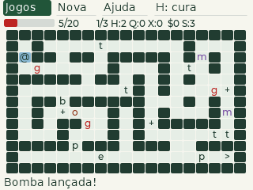
